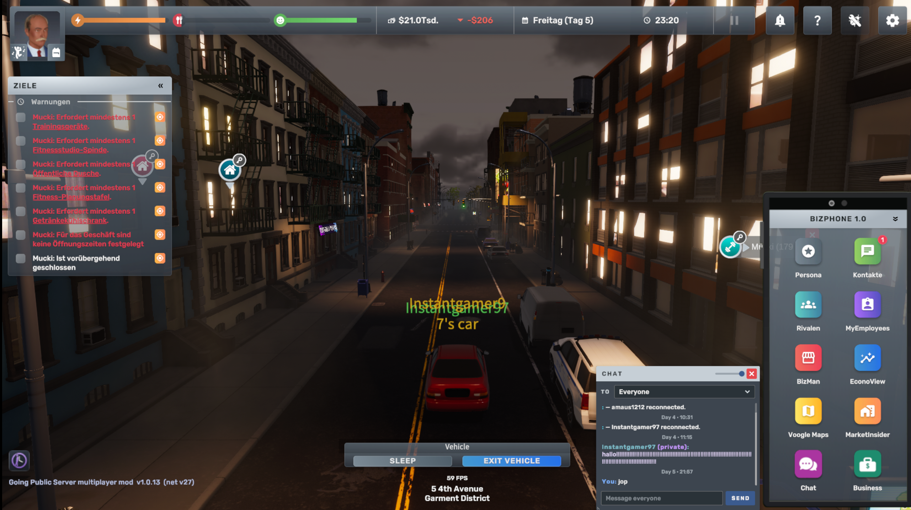
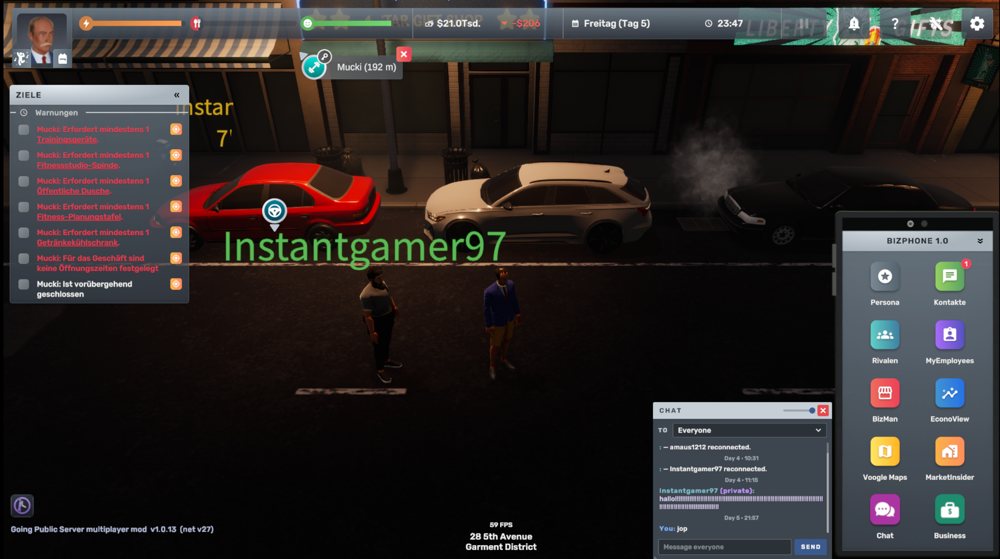
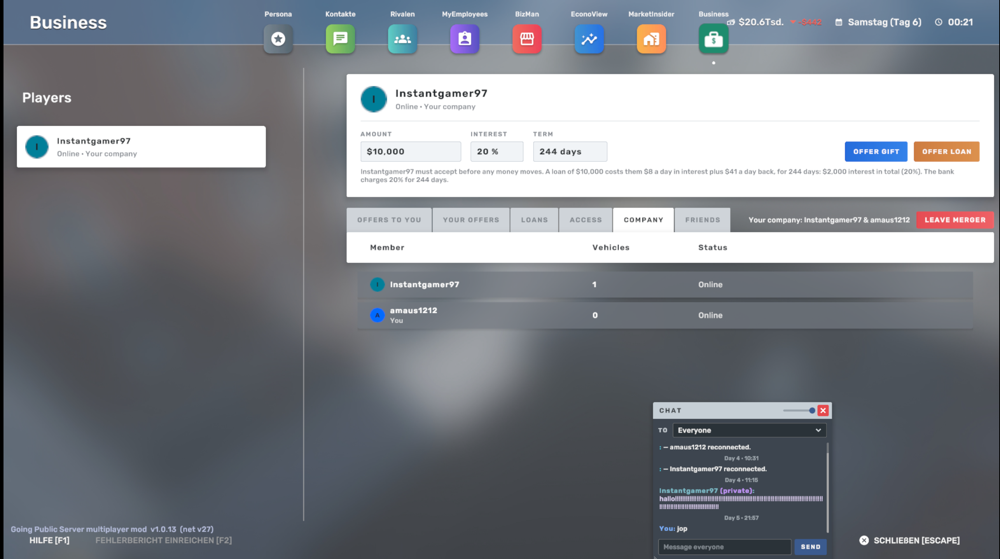

# Big Ambitions – Going Public Server







> The repository name has no hyphens on purpose: AMP cannot upgrade instances from template repositories whose name contains one.

**Always-on multiplayer server for Big Ambitions.** Play together on a dedicated server that keeps running: the world
stays when you log off, it pauses while nobody is online, and you join with the server's address and server key. The
server runs in the [AMP](https://cubecoders.com/AMP) game server panel or as a program of its own for Windows, Linux and
Docker; the game runs headless with the **Going Public Server** mod
([Steam Workshop](https://steamcommunity.com/sharedfiles/filedetails/?id=3829681182)).

*Deutsch weiter unten.*

## Important

- **Please do not use other mods.** Going Public Server brings everything listed below. Other mods can break the
  multiplayer - do not load them in the game or on the server (AMP: leave *Steam Workshop Items* empty and put nothing
  into `bamp-mods-extra/`). The built-in modules replace Immersion, BAScheduler, SmartSuite (SmartInsights),
  VoogleRoute, Big Ambitions Radio, Aluna's Phone Pages, IT Business Expansion with Skill Kit, and Spotless.
- **The server comes in several variants** ([Releases](https://github.com/amaus1209/BigAmbitionsGoingPublicServer/releases)): the template for the CubeCoders AMP game server panel
  (Linux, see *Server owners: AMP*), and a program of its own with a web interface for **Windows** and **Linux** and as
  a **Docker** container (see *Server owners: Windows, Linux, Docker*). Players can no longer host a game themselves:
  multiplayer means joining a dedicated server.
- **Please report bugs** under [Issues](https://github.com/amaus1209/BigAmbitionsGoingPublicServer/issues) or in the comments on the [Steam Workshop page](https://steamcommunity.com/sharedfiles/filedetails/?id=3829681182): with the
  version (bottom left in the game, e.g. "1.0.17 (9956f581)"), what happened and, if you can, the Player.log
  (Windows: `%USERPROFILE%\AppData\LocalLow\Hovgaard Games\Big Ambitions\Player.log`).
- **Server and players need the same version.** Steam keeps the players' subscription up to date; update the server
  when a new release is out.
- **Linux / Steam Deck (Proton):** play with **GE-Proton** (tested: GE-Proton11-11, the same as the server; install it
  with ProtonUp-Qt, then Properties → Compatibility). With Proton Experimental and Proton 11.0-2 the game crashed now
  and then while loading the world. Windows is not affected.

## Players: joining a server

1. Subscribe to **Going Public Server** in the Steam Workshop of Big Ambitions and enable it in the game's mod list.
2. **Multiplayer → Join Game**: **Host address** = the server's address, **Server key** = the key from the server
   admin. Or "Join Game" on a Steam friend who plays on the server.
3. Your progress stays on the server. **Escape → Leave server** saves it and takes you to the main menu.

## In the game

- **One shared world**: everybody plays in the same city; a player's cars stay where they are when he leaves
  ("offline"). After a dropped connection the game joins again by itself; weak connections get a lower network rate
  automatically.
- **Steam names and friends**: the name above every player, friends in green and on the city map, friend requests on
  the phone (Business → Friends) with your friends' buildings. Steam friends join you with one click, or you invite
  them.
- **Mergers**: several players' companies become one; it is dissolved only when everybody agrees (then everything is
  sold and the money shared).
- **Phone pages**: the BizPhone's apps in pages of eight with arrows, "1 / 2" and dots - the game's on page 1, the
  mod's on page 2: Chat, Business, Radio, Navigation, Planner, Insights, Camera, Signs; drag an app to move it, to
  another page too. Modelled on Aluna's Phone Pages.
- **New businesses** (modules 9-11): **IT firm** (IT Support, Software Development, Cloud Services: staff bill hours at
  IT workplaces, servers with blinking lights must stand in the office and cost power), **cleaning company** (the crews
  clean your own businesses first, then clients of the city pay) and **laundromat** (washers, dryers, wash and fold).
  Founded in BizMan, staff from the recruitment agencies, prices and shifts in BizMan, help under F1. Modelled on IT
  Business Expansion and Skill Kit by Cow a Bunga and Spotless by We1tall.
- **Chat** on the phone, with a sign for unread messages.
- **Internet radio**: a Radio app with the game's stations, the server's station list in its language and your own
  stations (http and https, with the song title), favourites, search and an alphabetical order. Radio on foot, shop
  loudspeakers with internet stations; passengers hear the driver's station.
- **Navigation** (Shift+F11 or the Navigation app): search a destination or click it on the city map; a sat-nav in the
  game's own look in the BizPhone with the streets, the next turn, street names, time left and arrival. The route is
  blue by car and orange on foot, with the right lane before a turn. A destination set on the map asks right there:
  walk there, drive there or the route only. A short right click into the world (map closed) deletes the route.
- **Self-driving**: in your own car "Drive there" takes you to the destination - indicating, stopping at red lights and
  for cars and people, keeping the speed limit, into car parks too - and parks there ("park automatically" on the bar
  at the bottom); it can follow a friend. On foot your character can walk there by itself.
- **Fast-forward time**: the button at the bottom left (or the window while sitting, sleeping, working out ...) asks
  everybody; once all agree, time runs faster up to the chosen time.
- **F6 RPG camera** (settings F8 or the Camera app): a third-person camera on foot and in the car.
- **F7 Shop signs** (the Signs app): your own pictures on signs, storefront signs and billboards; the other players see
  them.
- **Livery** (in your vehicle, next to "Park Vehicle"): left, right, back and front of every vehicle you own each get
  their own design, colour and logo place, with your business's logo and name, a slogan, a contact line and a new paint
  colour; the other players see it.
- **Shift+F9 Planner**: checks schedules, fills them with the game's own auto-fill and suggests opening hours from
  customer demand.
- **Shift+F10 Insights**: profit per business, history, sales, staff, real estate and alerts.
- **Pay taxes by phone**: Contacts → Internal Revenue Service → Call.
- **Riding along**: passengers see the wheels turn and steer and hear the driver's engine and radio; a seated player is
  shown seated.
- The mod's keys can be changed under Options → Controls. On the main menu: the mod's load status, these news and its
  version next to the game's.
- 23 languages; missing translations of other mods come with it (see *Translations of other mods*).
- **Error reports to the server**: on a server that collects them, the game asks once whether it may send its errors,
  warnings and the mod's check lines to that server (after a crash, or when the server asks, the whole Player.log too) -
  without the Windows user name, IP addresses, Steam IDs and keys. Change it under Options, tab Mods.
- **Chat translation**: on a server that translates, you read the others' German or English lines in the language of
  your game, the original small below. Off under Options, tab Mods ("Translate the chat").

## On the server

- Runs around the clock without graphics, saves by itself (autosave interval and count to choose), pauses while nobody
  is online, everybody is idle or everybody is in the pause menu. The frame rate with and without players and the
  network rate can be set.
- Joining with the server key; if the admin wants, **only players who own the game** (Steam confirms it with a Steam
  Web API key; Steam emulators stay out, Family Sharing counts). Steam friends can join.
- Worlds: choose a world, a new world with name and difficulty (custom values too), load a save once.
- Every module on or off on its own: taxes by phone, shop signs, RPG camera, planner, insights, navigation, phone pages;
  and the sat-nav in the phone, the route line and the camera settings for everybody.
- Game rules: rent from owned buildings, building prices, the bank's loan limit, business sale, and a merger that ends
  by itself once a member has been away for a set number of days.
- A radio station list per language for every player (the files in `radio/`, e.g. 250 German stations).
- **Administration**: an admin page in the browser (sign-in with the AMP account) with the players online (message,
  kick, ban with a reason), the chat to read and write, the ban list with unban, announcements on every screen, save,
  and a restart now or announced. In AMP: the chat in the console, Kick and Ban in the player list, a warning to the
  players before AMP stops the server. The server without AMP has the same in its *Players* tab.
- A ranking page in the browser with the players' buildings (who bought or rents which, with the business) and the
  server's numbers: network traffic, server FPS, each player's ping and loss.
- **Players' error reports** (AMP switch, on by default): the errors of the players who agreed land in
  `bigambitions/player-reports` - `summary.json` with every kind of error (how often, who, which build and system), one
  file per player and day, and whole Player.logs after a crash or with the console command `playerlog <player>`; kept
  14 days. The console command `reports` lists the most frequent ones.
- **Chat translation** (AMP switch, on by default): German <-> English, translated on the server itself - no account,
  no service on the internet. The first start sets it up once in `bigambitions/bamp-translate` (about 550 MB, not in the
  backups); the console command `translate <text>` tests it.
- Save backups; AMP in German, the settings in the server's language.

## News

<!-- Going Public Server 1.0.13+ shows every heading of this section as a card in the game's News panel on the
     main menu, newest first. German: the section "Neuigkeiten" in the German part. -->

### 1.0.17.3: Events, the network in the street, lines between players
- **Events** for Going Online: storms, a big match, an excavator, the press, a test win and a fibre subsidy - each with a decision in the app's overview.
- **The network in the street**: street cabinets by your connected buildings, road works while you connect them, cones where your technicians work.
- **Lines between players**: offer your network to other players or rent lines on theirs; more templates (customer centers A1 and C1, cable offices A3, C1 and D2).

### 1.0.17.2: Service vans with number plates
- **Number plates** "GO1-name", "GO2-name" on every service van you buy; the leased vans park at the headend and at the customers and drive through the city, with points on the city map.
- **Sliders** for the livery's text and logo size; the beacon flashes left and right, Q and E together switch it.
- **Templates** for the interior installation firm (customer center A2, cable office J1); newly hired staff count again.

### 1.0.17.1: Livery for every vehicle
- **Livery**: in your vehicle, "Livery" next to "Park Vehicle" - left, right, back and front each get their own design, colour and logo place, with your business's logo and name, a slogan, a contact line and a new paint colour. The stickers sit on the car's free surfaces; the other players see them.
- **Going Online's service van** is a real vehicle now: the dealers with vans sell it, you can drive it yourself, and its livery is set in the app's new tab "Service van". Its lights, blinkers and paint work like the game's cars.

### Going Public Server 1.0.17.1
- **Chat translation**: the server translates the chat between German and English - you read the others' lines in the language of your game, the original small below. It runs on the server itself; the chat never leaves it.
- **Going Online in an office**: headend and customer center under one roof; the agencies offer the jobs whose workplaces stand there. Own models for the seven racks and the devices, and up to three service vans with your logo in the traffic.
- **Crosswalks**: pedestrians cross only when the red lasts, cars stop for them - and new pedestrian lights at all crossings of the city show green.
- **Error reports to the server**: on servers that collect them (AMP switch "Player error reports"), each player is asked once; then the game sends its errors and the mod's check lines while playing, cleaned of personal data.
- **Going Online in BizMan**: the cable provider in the list of businesses, with the tabs Deliveries (contracts with wholesalers), Fleet and Inventory; the city map's filter "Cable provider"; a real logo; the requirements of every office business (course "Office Businesses", computers, toilets, sinks).
- **Self-driving** up to 60 km/h on long straights and 90 km/h on bridges (in multiplayer without the game's "Skip bridge", which jumped the clock), gently back to 40 before lights, junctions and curves; it no longer parks on a slope or off the parking lane.
- **Fast-forward window** in the game's style; after a fast-forward it closes by itself.
- **Fixes**: a server crash right after a player came into the world; getting out at the pier where no parking spot was free; the version line and the fast-forward button no longer cover "Driving shortcuts", and the fast-forward window opens above the vehicle panel; the recruitment agencies offer the cable jobs again after a reconnect; Going Online's devices no longer flood the server console; prices and names can be typed into Going Online's fields again.
- **Dissolve the company**: a cable provider without an office left can be ended in the app (Overview, "Dissolve the company"); then the app starts anew.

### Going Public Server 1.0.17
- **Going Online (module 8)**: a cable provider of your own, founded in BizMan. Connect buildings, sell internet, TV and phone lines against Skyline Cable (app "Going Online", Shift+F12).
- **Going Online in detail**: staff in six roles; DOCSIS 3.0 up to fiber; the equipment as furniture from the furniture store, devices from wholesalers and importers; help under F1. AMP switch "Going Online (cable provider)" (Modules tab), on by default.
- **Ranking page: cable providers** - "Cable provider: ..." under the name and a section of their own with company, customers, buildings and founding; new ones are marked.
- **Merger ends by itself** (AMP: "Merger: dissolve after days away", off by default): a member away for that many days leaves the company - everybody keeps their own property, the money is split equally.
- **Ranking page: Players' buildings** - which player bought or rents which building, with the address and the business, updated every 20 s.
- The save notices ("Saving the game on the server...", "Game saved on the server.") show at the top right with the game's notifications instead of in the middle of the screen.
- **Moving apps**: drag an app on the phone to another place - over an arrow to another page. The order is kept.
- **Walk or drive there**: the button at the top of the screen is gone. A destination set on the map asks right there: walk there, drive there (in the car) or the route only. In the car the vehicle panel's button row has "drive there" ("stop self-driving" while it drives); whether the car parks at the destination is set in the map's question.
- **Self-driving**: it parks in the free spot closest to the destination's door, and it no longer stops at posts and hydrants beside the lane (the car's width was measured too wide).
- **New businesses** (modules 9-11): IT firm (IT Support, Software Development, Cloud Services), cleaning company and laundromat - businesses of the game with their own staff, furniture and help. AMP switches "IT firm", "Cleaning company", "Laundromat" (Modules tab), on by default.
- **Ranking page**: the players' buildings follow each player's own report (sold buildings and old names are gone).
- **The lobby** follows the game's language; on a dedicated server it reads "Connected to the server". As a local mod, the game's mod list shows the mod's picture.
- **Fast-forward time**: a new icon (bottom left), the window and the vote line in the player's language, larger and on a dark plate.
- **Phone pages**: the BizPhone's apps in pages of eight with arrows, "1 / 2" and dots - the game's on page 1, the mod's on page 2: Chat, Business, Radio, Navigation, Planner, Insights, Camera and Signs open what their keys open. Modelled on Aluna's Phone Pages (our own code). AMP switch "Phone pages"; off = the phone as before.

### Going Public Server 1.0.16.3
- **Steam: only owners of the game** (AMP switch, with a Steam Web API key): the server lets in only players whose Steam account owns Big Ambitions - it has Steam confirm a ticket each player's game sends when joining, and a Steam emulator cannot make one. Family Sharing counts.
- **Steam: friends can join**: while you play on a server, your Steam friends see "Join Game" on you (and you can invite them) and land on the same server with one click - address and server key included. The admin can switch it off in AMP.
- **AMP switch "Navigation: sat-nav in the phone"**: whether the sat-nav fills the BizPhone whenever a destination is set (off = it stands on top of the phone).
- **Admin page** on the ranking site (sign-in with the AMP account): players online with message, kick and ban (with a reason), the chat to read and write, the ban list with unban, announcements on every player's screen, save, and a restart now or announced in a few minutes (the players are warned). `kick` now only puts a player out; the chat shows in AMP's console, and AMP's player list has Kick and Ban.

### Going Public Server 1.0.16.2
- **Internet radio plays**: in 1.0.16.1 every stream stayed silent (the game engine cannot play an endless MP3 stream) - the mod now decodes the streams itself. http and https stations; the song that plays shows under the station's name; an "Alphabetical" switch sorts the stations by name.
- **Radio on foot**: a switch in the phone's Radio tab - the radio keeps playing out of the car, also without headphones; inside buildings it is silent (the loudspeakers play there).
- **Shop loudspeakers** play internet stations too: in your shop, the Radio tab picks for "Shop loudspeakers", and a loudspeaker's "Next station" goes on into the internet stations. Everybody in the shop hears the same station; the server keeps it with the world.
- **Radio tab**: favourites with a heart (they stand at the top, and "next station" goes through them), a search field, a clear word when a station sends AAC or HLS instead of MP3.
- **Passengers** hear the driver's station (internet stations too); after getting out their own radio plays again.
- **Navigation device**: with a destination set, a small sat-nav in the game's own look in the BizPhone's screen (with the mouse over it the phone's apps show through) shows the next turn, the streets around you with the route and the distance left (the map shows the whole route). Routes change lanes where the game's lanes are not linked (no more driving to the end of the road before turning, as at the harbour), turn from the outer lane and keep right. A drive shows in blue, a walk in orange - on the map and in the sat-nav.
- AMP shows the server key and version again (they vanished from the console once the world was up).

### Going Public Server 1.0.16.1
- **Self-driving** stops at red lights, steers properly into turns, no longer drives into hydrants and blinks.
- **Passengers** see the wheels turn and steer and hear the engine and the driver's radio.
- **Radio**: a Radio tab in the phone's menu to pick the station. The server's station list comes from GitHub in the language chosen in AMP (250 German stations; the most popular stations of the country for more languages); https streams only; your own stations in `streams.txt`.
- A world with energy/hunger off stays that way after a restart or a reconnect.
- A sitting player is shown sitting to the others; an NPC on his seat is hidden meanwhile.
- **Merger**: dissolving needs every member's agreement and sells everything first (shops with goodwill, bought buildings at market value, cars and homes; the staff are let go) - then the money is shared equally. A merged member gets the partner's staff list back after a reconnect.
- The version line at the bottom left reads "GPS-MM v. 1.0.16.1".

### Going Public Server 1.0.16
- A player's cars stay in the world when he leaves; a car left in the road or parked illegally is parked at the roadside. Back on the server, his cars stand where the others saw them.
- A short right click into the world (not on a building or object, map closed) deletes the route.
- The wheels of the cars driving past turn and steer.
- **Self-driving**: in your car, "Drive there" (top of the screen, or "Drive there automatically" on the map's building card) drives you to the destination - blinkers in turns, stops at red lights and for cars and people ahead - and parks there. Steering, throttle or brake take over.
- Walking routes show **road** (orange) and **footpath** (blue).
- The mod keys (F6, F7, F8, Shift+F9/F10/F11) can be changed under **Options, Controls**.
- Smoother traffic: cars no longer jerk back on your screen, and on the server they brake in time behind the car ahead. Other players move smoothly too, even when packets get lost.
- A lost connection no longer pauses the world (AMP: "Pause when a connection drops"); the game joins the server again by itself. Weak links get a lower network rate automatically.
- Navigation: the shortest route, turn hints ("Turn right in 80 m"); self-driving follows the road's speed limit, drives into car parks and can follow a friend.
- Absent players' cars show "(offline)" and a grey pin on the map; a note (or, if set, a refusal) for an older mod version; less waiting when joining.
- **Server numbers on the ranking page**: network in and out in one chart (two colours), messages, server FPS, throttled players and each player's ping and loss; AMP's status page is tidy again.

### Going Public Server 1.0.15
- Linux/Proton: game hooks are written as self-contained jumps - fixes "Open in BizMan" showing the empty list instead of the building (rent, buy) and other rare failures there.
- The navigation names a destination by its address ("44 Second Street") instead of the street key.

### Going Public Server 1.0.14
- The load status shows while the game loads the mod; the server's own character is gone everywhere.
- Passengers see car parks, friends show their buildings, "Walk there automatically" on the map's building card.
- AMP: 60/120/200 FPS, a network rate setting; new worlds take the Custom values from the first start.

### Going Public Server 1.0.13
- Linux/Proton: the test file skip-tiny-patches.txt no longer turns multiplayer off.
- The main menu shows the mod's load status and these news; the mod's version is next to the game's.
- The bug report of the original Going Public is gone.

### 1.0.12: Joining a server
The server saves first, then lets you in, and always loads its own copy of your save. A save made inside a
building now starts you in front of it.

### 1.0.12: Built-in modules
F6 RPG camera (F8 settings), F7 shop signs, Shift+F9 planner, Shift+F10 insights, Shift+F11 navigation. The
server admin switches each one on or off in AMP.

### 1.0.12: Steam names and friends
Steam names above the players, friends in green and on the city map, a Friends tab on the phone's Business
page. Taxes by phone: Contacts -> Internal Revenue Service.

## Server owners: AMP

### Installing

1. In AMP (ADS): **Configuration → Instance Deployment → Configuration Repositories**, add
   `amaus1209/BigAmbitionsGoingPublicServer:main`, then **Fetch latest**.
2. Create an instance from the template **Big Ambitions (Going Public server)**.
3. In the instance: **Update**. AMP downloads the game with SteamCMD (it asks for a Steam login that owns
   Big Ambitions, and the Steam Guard code if the account has one), Proton GE, and the newest
   **Going Public Server** release from this repository.
4. **Start**. The console shows `[BAMP-HEADLESS] READY`; the status page shows the game port, the **server password** (the server key players join with), and the server version (gone after reloading the page? AMP's page misses them with Websockets on: switch off "Enable Websockets" in the instance's configuration). Network traffic, server FPS and each player's connection are on the ranking page (see below).
5. Open the game port (UDP, 7777 by default) in your firewall.
6. AMP without Docker: the host needs `xvfb`, `xauth` and `python3` (`sudo apt install xvfb xauth python3`) - the game
   runs under Proton with a virtual display. AMP's Docker containers bring them along.

### Updating

- **Update** downloads the newest release; restart the instance afterwards. Players get the matching version from the
  Steam Workshop.
- After an update, start the server once: new settings get their default then, and values set in AMP apply from the
  next start.
- **Stop** saves the world first and then ends the server (a few seconds).

### Settings (the instance's Configuration page)

- **Server language**: choose it, then run **Update** once more to see the settings in that language.
- **Server**: world, load a save once, the server's character name, max players, pausing (empty, idle, everyone in
  the pause menu), server key, autosave, **Frame cap while running** (60, 120 or 200 FPS) and while empty, and
  **Network rate** (Normal 10 / 5 Hz, High 20 / 10 Hz, Very high 30 / 15 Hz, Maximum 60 / 30 Hz - how often
  positions, cars and traffic go over the network; higher drives more smoothly, and since every player's stream goes
  to every other player, the data grows quickly with more players).
- **Warning before AMP stops the server** (on the Server tab): when AMP stops, restarts or updates the server while
  players are on, they are warned first (default 60 s, at 60, 30 and 10 s), then the world is saved. Announcements and a
  longer announced restart from AMP itself: in the console `notice <text>` and `restart <minutes>` (`restart cancel`), or
  as a task "Send console message" with those commands in the instance's **Schedule** (e.g. every day at 4:00
  `restart 5`).
- **Steam** (on the Server tab): **only players who own the game** - needs a **Steam Web API key** from
  steamcommunity.com/dev/apikey (any Steam account that has bought something can make one; it stays on the server) -
  and **friends can join** (the players' Steam friends see Join Game).
- **New world**: name and difficulty (Easy, Normal, Hard or Custom - the Custom values have their own tab). They only
  count when the server creates that world (it does not exist yet).
- **Modules**: switch each built-in module on or off for everybody (phone pages included). **RPG camera**, the navigation's route line and
  whether the sat-nav lies in the phone are the same for every player
  on the server. **Radio station list**: the language of the radio stations every player gets
  (the files in `radio/` of this repository - edit one to change that list for everybody; Off = none).
- **Game rules**: rent from owned buildings, building prices, bank loan limit and business sale. **Merger: dissolve
  after days away**: a member who has not been on the server for that many days (counted while the server runs) leaves the company by themselves,
  without the vote and the sale - everybody keeps their own property, the company's money is split equally, a merger of
  two ends (only while another member was there; 0 = never).

### On the host: ranking page, save backups, AMP in German

Instances run in containers and cannot reach AMP's web folder, so small jobs run on the host, as the user AMP runs as
(`crontab -e`; the scripts come with every instance in `bigambitions/bamp-tools/`):

```
* * * * *  ~/.ampdata/instances/<instance>/bigambitions/bamp-tools/bamp-web-sync.sh
17 4 * * * ~/.ampdata/instances/<instance>/bigambitions/bamp-tools/backup-saves.sh --all >> ~/backups/saves/backup.log 2>&1
```

- **Admin page**: `https://<your AMP address>/monitor/<game port>/index.html#admin` - in AMP on the instance's status
  page as "Admin Seite" under the Connection Link, on the ranking page as *Admin* at the top right and below the table -
  sign in with your AMP account; in AMP it needs the right to use that instance's console. Players online
  (message, kick, ban with a reason), the chat (read along, write as the server or to one player), the ban list
  (unban, unban everyone), save and restart. In AMP itself the chat shows in the console, and the player list has Kick
  and Ban.
- `bamp-web-sync.sh` serves each instance's ranking at `https://<your AMP address>/monitor/<game port>/index.html`
  (the instance's Connection Link); players open it with their server's key. Merged companies show as "merged with ...". Below the ranking,
  **Players' buildings** lists every building a player bought or rents or runs, with the business (updated every 20 s, sortable
  by each column), and **Server**
  shows the last hour: network traffic in and out, messages, server FPS, the network rate, throttled players and each
  player's ping, packet loss and rate (the server writes it every 15 s). It also copies a German
  translation of AMP's own interface into AMP's web folder: open AMP once with `https://<your AMP address>/?lang=de`
  (per browser).
- `backup-saves.sh --all` saves every instance's multiplayer saves to `~/backups/saves/` (14 per instance).

## Server owners: Windows, Linux, Docker

The server as a program of its own with a web interface and sign-in, without AMP - the packages are under
[Releases](https://github.com/amaus1209/BigAmbitionsGoingPublicServer/releases). Each comes with a LIESMICH (German and English) with the details.

- **Windows** (`GoingPublicServer-<version>-Windows.zip`): unpack it to a fixed place (about 10 GB free) and start
  `GoingPublicServer.exe`; the access data to the web interface show once, in a window of their own. Open
  `http://localhost:8080`. Closing the black window stops the server (it saves first).
- **Linux** (Debian/Ubuntu, `GoingPublicServer-<version>-Linux.tar.gz`): unpack it and run `sudo ./install.sh` - it
  installs the packages, the user `goingpublic`, `/opt/goingpublicserver` and the service `goingpublicserver`; the access
  data show once in the terminal. Open `http://<server>:8080`.
- **Docker** (`GoingPublicServer-<version>-Docker.zip`): `docker compose up -d --build`; `docker compose logs
  goingpublicserver` shows the access data once.

Then in the web interface: download the game under *Installation* with a Steam account that owns Big Ambitions (on
Linux and Docker also Proton GE), choose or create a world under *Settings*, and *Start* on the overview. Forward UDP
7777 (the game); open TCP 8080 (the web interface) from outside only behind HTTPS or a VPN.

## Translations of other mods

Going Public Server adds the game languages other mods are missing (for the mods players run themselves - the server
runs none). The tables are in `ModTranslations/`; the game fetches them at every start, so a new translation needs no
mod update.

**Translating yourself:** at every start the server writes one ready file per mod and language to
`bigambitions/modtr-templates/ModTranslations/` (AMP file manager) - laid out like `ModTranslations/` here, with the
current translation or, where there is none, the English text. Translate only the text after the colon; keep keys,
placeholders (`{0}`, `{name}`) and tags (`<b>`). Upload the file to the same path here (Add file → Upload files). The
*Translations* action checks it and renews `index.json`; a red X under *Actions* names a line to fix.

## Credits

Unofficial fork of [Going Public](https://github.com/Melaus123/BigAmbitionMulti) by Melaus (MIT license).

The built-in modules are our own implementations, modelled on these Workshop mods. Many thanks to their authors:

- RPG camera: [Immersion - RPG Camera](https://steamcommunity.com/sharedfiles/filedetails/?id=3791985529) by Chamiks
- Planner: [BAScheduler - Schedule, Staff & Opening Hours Planner](https://steamcommunity.com/sharedfiles/filedetails/?id=3795741870) by Shanpapa
- Insights and game rules: [SmartSuite Empire Management](https://steamcommunity.com/sharedfiles/filedetails/?id=3793254452) (SmartInsights, SmartRent) by ᗪEEᒍ Gᗩᑌᗪᗩᖇᗪ
- Navigation: [Voogle Route](https://steamcommunity.com/sharedfiles/filedetails/?id=3740623471) with
  [LIB BA Player Location](https://steamcommunity.com/sharedfiles/filedetails/?id=3741773276) and
  [LIB BA Unified UI](https://steamcommunity.com/sharedfiles/filedetails/?id=3790426259) by - Capitaine -
- Internet radio: [Big Ambitions Radio](https://steamcommunity.com/sharedfiles/filedetails/?id=3792403626) by Antegarr
- Phone pages: [Aluna's Phone Pages](https://steamcommunity.com/sharedfiles/filedetails/?id=3739104140) by aluna
- IT firm: [IT Business Expansion](https://steamcommunity.com/sharedfiles/filedetails/?id=3741969623) and
  [Skill Kit](https://steamcommunity.com/sharedfiles/filedetails/?id=3795855100) by Cow a Bunga
- Cleaning company and laundromat: [Spotless: Cleaning Company & Laundromat](https://steamcommunity.com/sharedfiles/filedetails/?id=3833316897) by We1tall

[Claude Code](https://claude.com/claude-code), the AI assistant by Anthropic, helped with the development and with
finding and fixing bugs - among other things the Steam ownership check, the admin page, the sat-nav and the phone pages.

Big Ambitions belongs to Hovgaard Games; every player and the server need their own copy of the game.

---

## Deutsch

### Wichtig

- **Bitte keine anderen Mods benutzen.** Going Public Server bringt alles mit, was unten steht. Andere Mods können den
  Mehrspieler stören - weder im Spiel noch auf dem Server zusätzlich laden (AMP: *Steam Workshop Items* leer lassen und
  nichts nach `bamp-mods-extra/` legen). Die eingebauten Module ersetzen Immersion, BAScheduler, SmartSuite
  (SmartInsights), VoogleRoute, Big Ambitions Radio, Alunas Phone Pages, IT Business Expansion mit Skill Kit und Spotless.
- **Den Server gibt es in mehreren Varianten** ([Releases](https://github.com/amaus1209/BigAmbitionsGoingPublicServer/releases)): die Vorlage für das Gameserver-Panel CubeCoders AMP
  (Linux, siehe *Server-Betreiber: AMP*) und ein eigenes Programm mit Weboberfläche für **Windows** und **Linux** sowie
  als **Docker**-Container (siehe *Server-Betreiber: Windows, Linux, Docker*). Spieler können selbst kein Spiel mehr
  hosten: Mehrspieler heißt, einem dedizierten Server beizutreten.
- **Fehler bitte melden** unter [Issues](https://github.com/amaus1209/BigAmbitionsGoingPublicServer/issues) oder in den Kommentaren der [Steam-Workshop-Seite](https://steamcommunity.com/sharedfiles/filedetails/?id=3829681182): mit der
  Version (unten links im Spiel, z. B. „1.0.17 (9956f581)“), was passiert ist und, wenn möglich, der Player.log
  (Windows: `%USERPROFILE%\AppData\LocalLow\Hovgaard Games\Big Ambitions\Player.log`).
- **Server und Spieler brauchen dieselbe Version.** Steam hält das Abo der Spieler aktuell; den Server nach einem neuen
  Release aktualisieren.
- **Linux / Steam Deck (Proton):** mit **GE-Proton** spielen (getestet: GE-Proton11-11, wie der Server; mit
  ProtonUp-Qt installieren, dann Eigenschaften → Kompatibilität). Mit Proton Experimental und Proton 11.0-2 stürzte
  das Spiel gelegentlich beim Laden der Welt ab. Unter Windows tritt das nicht auf.

### Spieler: einem Server beitreten

1. **Going Public Server** im Steam Workshop von Big Ambitions abonnieren und in der Mod-Liste des Spiels aktivieren.
2. **Mehrspieler → Spiel beitreten**: **Host-Adresse** = Adresse des Servers, **Server-Schlüssel** = der Schlüssel vom
   Server-Admin. Oder bei einem Steam-Freund, der auf dem Server spielt: „Spiel beitreten“.
3. Dein Fortschritt bleibt auf dem Server. **Esc → Server verlassen** speichert ihn und bringt dich ins Hauptmenü.

### Im Spiel

- **Gemeinsame Welt**: Alle spielen in derselben Stadt; die Autos eines Spielers bleiben stehen, wenn er geht
  („offline“). Nach einem Verbindungsabbruch tritt das Spiel selbst wieder bei; schwache Verbindungen bekommen
  automatisch einen niedrigeren Takt.
- **Steam-Namen und Freunde**: Name über jedem Spieler, Freunde in Grün und auf der Stadtkarte, Freundschaftsanfragen
  im Handy (Spieler → Freunde) mit den Gebäuden der Freunde. Steam-Freunde treten dir mit einem Klick bei, oder du lädst
  sie ein.
- **Fusion**: Firmen mehrerer Spieler zu einer zusammenlegen; Auflösen nur, wenn alle zustimmen (dann wird alles
  verkauft und das Geld geteilt).
- **Handy-Seiten**: die Apps des BizPhones auf Seiten zu acht mit Pfeilen, „1 / 2“ und Punkten - die des Spiels auf
  Seite 1, die der Mod auf Seite 2: Chat, Spieler, Radio, Navi, Planer, Auswertung, Kamera, Schilder; eine App mit der
  Maus an eine andere Stelle ziehen, auch auf eine andere Seite. Nachgebaut nach Alunas Phone Pages.
- **Neue Unternehmen** (Module 9-11): **IT-Firma** (IT-Support, Softwareentwicklung, Cloud-Dienste: das Personal rechnet
  Stunden an IT-Arbeitsplätzen ab, Server mit blinkenden Lämpchen müssen im Büro stehen und kosten Strom),
  **Reinigungsfirma** (die Kräfte putzen zuerst die eigenen Geschäfte, dann zahlt Kundschaft der Stadt) und
  **Waschsalon** (Waschmaschinen, Trockner, Waschen & Falten). Gegründet in BizMan, Personal von den Personalagenturen,
  Preise und Schichten in BizMan, Hilfe unter F1. Nachgebaut nach IT Business Expansion und Skill Kit von Cow a Bunga
  und Spotless von We1tall.
- **Chat** im Handy, mit Hinweis auf ungelesene Nachrichten.
- **Internetradio**: Radio-App mit den Sendern des Spiels, der Senderliste des Servers in seiner Sprache und eigenen
  Sendern (http und https, mit Liedtitel), Favoriten, Suche und alphabetischer Sortierung. Radio zu Fuß,
  Laden-Lautsprecher mit Internetsendern; Mitfahrer hören den Sender des Fahrers.
- **Navigation** (Umschalt+F11 oder App „Navi“): Ziel suchen oder auf der Stadtkarte anklicken; ein Navi im Stil des
  Spiels im BizPhone mit Kartenausschnitt, nächster Abbiegung, Straßennamen, Restzeit und Ankunft. Route im Auto blau,
  zu Fuß orange, mit Spurwahl vor dem Abbiegen. Wer auf der Karte ein Ziel setzt, wird gleich gefragt: Hinlaufen,
  Hinfahren oder nur Navi. Ein kurzer Rechtsklick in die Welt (Karte zu) löscht die Route.
- **Autopilot**: Im eigenen Auto fährt „Hinfahren“ zum Ziel - mit Blinker, Halt an Ampeln und vor Autos und Personen,
  Tempolimit, auch in Parkhäuser - und parkt dort („Automatisch parken“ in der Leiste unten); er kann einem Freund
  folgen. Zu Fuß läuft die Figur auf Wunsch selbst hin.
- **Zeit vorspulen**: Der Knopf unten links (oder das Fenster beim Sitzen, Schlafen, Trainieren …) fragt alle; stimmen
  alle zu, läuft die Zeit bis zur gewählten Uhrzeit schneller.
- **F6 RPG-Kamera** (Einstellungen F8 oder App „Kamera“): Kamera hinter der Figur, zu Fuß und im Auto.
- **F7 Ladenschilder** (App „Schilder“): eigene Bilder auf Schildern, Ladenschildern und Werbetafeln; die anderen
  Spieler sehen sie.
- **Beklebung** (im Fahrzeug neben „Fahrzeug parken“): links, rechts, hinten und vorne jedes eigenen Fahrzeugs je eine
  eigene Gestaltung, Farbe und ein Logo-Platz, dazu Logo und Name deiner Firma, ein Spruch, eine Kontaktzeile und eine
  neue Lackfarbe; die anderen sehen sie.
- **Umschalt+F9 Planer**: prüft Schichtpläne, füllt sie mit der Funktion des Spiels und schlägt Öffnungszeiten nach
  Kundenandrang vor.
- **Umschalt+F10 Auswertung**: Gewinn je Geschäft, Verlauf, Verkäufe, Personal, Immobilien und Warnungen.
- **Steuern per Telefon**: Kontakte → Internal Revenue Service → Anrufen.
- **Mitfahren**: Mitfahrer sehen die Räder drehen und lenken und hören Motor und Radio des Fahrers; ein sitzender
  Mitspieler wird sitzend gezeigt.
- Die Mod-Tasten lassen sich unter Optionen → Steuerung ändern. Im Hauptmenü: Ladestatus, diese Neuigkeiten und die
  Mod-Version neben der des Spiels.
- 23 Sprachen; fehlende Übersetzungen anderer Mods kommen mit.
- **Fehlerberichte an den Server**: Auf einem Server, der sie sammelt, fragt das Spiel einmal, ob es seine Fehler,
  Warnungen und die Prüfzeilen des Mods an diesen Server schicken darf (nach einem Absturz oder auf Anfrage des Servers
  auch die ganze Player.log) – ohne Windows-Benutzernamen, IP-Adressen, Steam-IDs und Schlüssel. Ändern unter Optionen,
  Reiter Mods.
- **Chat-Übersetzung**: Auf einem Server, der übersetzt, liest du die deutschen oder englischen Zeilen der anderen in der
  Sprache deines Spiels, darunter klein das Original. Abschalten unter Optionen, Reiter Mods („Chat übersetzen“).

### Auf dem Server

- Läuft rund um die Uhr ohne Grafik, speichert automatisch (Abstand und Anzahl der Autosaves einstellbar), pausiert,
  wenn niemand da ist, alle inaktiv sind oder alle im Pausenmenü stehen. Bildrate im Betrieb und ohne Spieler sowie der
  Netzwerk-Takt sind einstellbar.
- Beitritt mit Server-Schlüssel; auf Wunsch **nur Spieler mit gekauftem Spiel** (Steam bestätigt es mit einem
  Steam-Web-API-Schlüssel; Steam-Emulatoren bleiben draußen, die Familienbibliothek zählt). Steam-Freunde können
  beitreten.
- Welten: Welt wählen, neue Welt mit Name und Schwierigkeit (auch eigene Werte), einen Spielstand einmal laden.
- Jedes Modul einzeln an oder aus: Steuern per Telefon, Ladenschilder, RPG-Kamera, Planer, Auswertung, Navigation,
  Handy-Seiten, Going Online (Kabelanbieter); dazu Navi im Handy, Routenlinie und Kamera-Einstellungen für alle.
- Spielregeln: Miete aus eigenen Gebäuden, Gebäudepreise, Kreditrahmen der Bank, Geschäftsverkauf, und eine Fusion, die
  sich von selbst auflöst, wenn ein Mitglied eine einstellbare Zahl von Tagen weg ist.
- Radio-Senderliste je Sprache für alle Spieler (die Dateien in `radio/`, z. B. 250 deutsche Sender).
- **Verwaltung**: Admin-Seite im Browser (Anmeldung mit dem AMP-Konto) mit den Spielern online (Nachricht, Kicken,
  Bannen mit Grund), Chat zum Mitlesen und Schreiben, Bannliste mit Entbannen, Ankündigungen auf jedem Bildschirm,
  Speichern und Neustart sofort oder angekündigt. In AMP: Chat in der Konsole, Kick und Ban in der Spielerliste, Warnung
  an die Spieler, bevor AMP den Server stoppt. Der Server ohne AMP hat dasselbe im Reiter *Spieler*.
- Rangliste im Browser mit den Gebäuden der Spieler (wer welches gekauft oder gemietet hat, mit dem Geschäft), den
  Kabelanbietern der Spieler und den Serverwerten: Netzverkehr, Server-FPS, Ping und Verlust je Spieler.
- **Fehlerberichte der Spieler** (AMP-Schalter, ab Werk an): Die Fehler der Leute, die zugestimmt haben, landen in
  `bigambitions/player-reports` – `summary.json` mit jeder Art von Fehler (wie oft, bei wem, welcher Build und welches
  System), eine Datei je Person und Tag, und ganze Player.logs nach einem Absturz oder mit dem Konsolenbefehl
  `playerlog <Name>`; sie bleiben 14 Tage. Der Konsolenbefehl `reports` zeigt die häufigsten.
- **Chat-Übersetzung** (AMP-Schalter, ab Werk an): Deutsch <-> Englisch, übersetzt auf dem Server selbst – kein Konto,
  kein Dienst im Internet. Der erste Start richtet sie einmalig in `bigambitions/bamp-translate` ein (etwa 550 MB, nicht
  in den Sicherungen); der Konsolenbefehl `translate <Text>` testet sie.
- Sicherungen der Spielstände; AMP auf Deutsch, die Einstellungen in der Server-Sprache.

### Neuigkeiten

#### 1.0.17.3: Ereignisse, Netz in der Stadt, Leitungen an Mitspieler
- **Ereignisse** für Going Online: Unwetter, ein großes Fußballspiel, ein Bagger, die Zeitung, ein Testsieg und eine Glasfaser-Förderung – jeweils mit einer Entscheidung in der Übersicht der App.
- **Netz in der Stadt**: Verteilerkästen an deinen angeschlossenen Häusern, Baustellen beim Anschließen, Kegel, wo deine Technik arbeitet.
- **Leitungen an Mitspieler**: dein Netz anderen Spielern anbieten oder Leitungen in ihrem mieten; mehr Vorlagen (Kundencenter A1 und C1, Kabel-Büros A3, C1 und D2).

#### 1.0.17.2: Servicewagen mit Kennzeichen
- **Kennzeichen** „GO1-Name“, „GO2-Name“ an jedem gekauften Servicewagen; geleaste Wagen parken an der Kopfstelle und bei der Kundschaft und fahren durch die Stadt, mit Punkten auf der Stadtkarte.
- **Schieberegler** für Schrift- und Logogröße der Beklebung; die Rundumleuchte blitzt links und rechts, Q und E zusammen schalten sie.
- **Vorlagen** für die Inneneinrichtungsfirma (Kundencenter A2, Kabel-Büro J1); neu eingestellte Leute zählen wieder.

#### 1.0.17.1: Beklebung für jedes Fahrzeug
- **Beklebung**: im Fahrzeug „Beklebung“ neben „Fahrzeug parken“ – links, rechts, hinten und vorne je eine eigene Gestaltung, Farbe und ein Logo-Platz, dazu Logo und Name deiner Firma, ein Spruch, eine Kontaktzeile und eine neue Lackfarbe. Die Aufkleber sitzen auf den freien Flächen des Autos; die anderen sehen sie.
- **Der Servicewagen von Going Online** ist jetzt ein echtes Fahrzeug: Die Autohäuser mit Transportern verkaufen ihn, du kannst ihn selbst fahren, und seine Beklebung stellst du im neuen Reiter „Servicewagen“ der App ein. Licht, Blinker und Lack wie bei den Spielautos.

#### Going Public Server 1.0.17.1
- **Chat-Übersetzung**: Der Server übersetzt den Chat zwischen Deutsch und Englisch – du liest die Zeilen der anderen in der Sprache deines Spiels, darunter klein das Original. Das läuft auf dem Server selbst.
- **Going Online im Büro**: Kopfstelle und Kundencenter unter einem Dach; die Agenturen bieten die Berufe an, deren Arbeitsplätze dort stehen. Eigene Modelle für die Schränke und Geräte, bis zu drei Servicewagen mit deinem Logo im Verkehr.
- **Zebrastreifen**: Die Leute gehen nur los, wenn das Rot reicht, Autos halten für sie – und neue Fußgängerampeln an allen Übergängen der Stadt zeigen Grün.
- **Fehlerberichte an den Server**: Auf Servern, die sie sammeln (AMP-Schalter „Fehlerberichte der Spieler“), wird jede Person einmal gefragt; danach schickt das Spiel beim Spielen seine Fehler und die Prüfzeilen des Mods, ohne persönliche Daten.
- **Going Online in BizMan**: der Kabelanbieter in der Liste der Unternehmen, mit den Reitern Lieferungen (Verträge mit Großhändlern), Fuhrpark und Inventar; der Kartenfilter „Kabelanbieter“; ein echtes Logo; die Anforderungen wie bei jedem Bürounternehmen (Kurs „Bürounternehmen“, Computer, Toiletten, Waschbecken).
- **Autofahrt** auf langen Geraden bis 60 km/h und auf Brücken bis 90 km/h (im Mehrspieler-Spiel ohne „Brücke überspringen“ des Spiels, das die Uhr springen ließ), vor Ampeln, Kreuzungen und Kurven sanft zurück auf 40; sie parkt nicht mehr am Hang oder neben der Parkspur.
- **Vorspul-Fenster** im Stil des Spiels; nach dem Vorspulen schließt es sich von selbst.
- **Korrekturen**: ein Absturz des Servers kurz nachdem jemand in die Welt kam; Aussteigen am Pier, wo kein Parkplatz frei war; Versionszeile und Vorspul-Knopf verdecken „Tastenkürzel fürs Fahren“ nicht mehr, das Vorspul-Fenster öffnet sich über der Fahrzeuganzeige; die Personalagenturen bieten die Kabel-Berufe auch nach einem Neuverbinden an; die Geräte von Going Online fluten die Server-Konsole nicht mehr; Preise und Namen lassen sich in Going Online wieder eintippen.
- **Firma auflösen**: Ein Kabelanbieter ohne Büro lässt sich in der App beenden (Übersicht, „Firma auflösen“); danach beginnt die App von vorn.

#### Going Public Server 1.0.17
- **Going Online (Modul 8)**: ein eigener Kabelanbieter, gegründet in BizMan. Häuser anschließen, Internet, Fernsehen und Telefon verkaufen, gegen Skyline Cable (App „Going Online“, Umschalt+F12).
- **Going Online im Einzelnen**: Personal in sechs Rollen; DOCSIS 3.0 bis Glasfaser; Technik als Möbel aus dem Möbelladen, Geräte von Großhändlern und Importeuren; Hilfe unter F1. AMP-Schalter „Going Online (Kabelanbieter)“ (Reiter Module), ab Werk an.
- **Rangliste: Kabelanbieter** – unter dem Namen „Kabelanbieter: …“ und ein eigener Abschnitt mit Firma, Anschlüssen,
  Häusern und Gründung; neue Gründungen sind markiert.
- **Fusion löst sich von selbst auf** (AMP: „Fusion: auflösen nach Tagen Abwesenheit“, ab Werk aus): Ein Mitglied, das so viele Tage weg ist, scheidet aus - alle behalten ihr Eigentum, das Geld wird gleichmäßig geteilt.
- **Rangliste: Gebäude der Spieler** - welcher Spieler welches Gebäude gekauft oder gemietet hat, mit Adresse und Geschäft, alle 20 s neu.
- Die Speicher-Meldungen („Spielstand wird auf dem Server gespeichert …“, „… gespeichert“) erscheinen oben rechts bei den Benachrichtigungen des Spiels statt in der Bildmitte.
- **Apps verschieben**: Eine App im Handy mit der Maus an eine andere Stelle ziehen - über einem Pfeil auf eine andere Seite. Die Reihenfolge bleibt.
- **Hinlaufen oder hinfahren**: Der Knopf oben im Bild ist weg. Wer auf der Karte ein Ziel setzt, wird gleich dort gefragt: Hinlaufen, Hinfahren (im Auto) oder nur Navi. Im Auto steht in der Knopfleiste der Fahrzeuganzeige „Hinfahren“ (während der Fahrt „Autofahrt stoppen“); ob das Auto am Ziel einparkt, stellt man bei der Frage auf der Karte ein.
- **Autofahrt**: Sie parkt auf dem freien Platz, der der Tür des Ziels am nächsten ist, und bleibt nicht mehr an Pfosten und Hydranten neben der Spur stehen (die Breite des Autos war zu groß gemessen).
- **Neue Unternehmen** (Module 9-11): IT-Firma (IT-Support, Softwareentwicklung, Cloud-Dienste), Reinigungsfirma und Waschsalon - Unternehmen des Spiels mit eigenem Personal, eigenen Möbeln und Hilfe. AMP-Schalter „IT-Firma“, „Reinigungsfirma“, „Waschsalon“ (Reiter Module), ab Werk an.
- **Rangliste**: Die Gebäude der Spieler folgen der Meldung jedes Spielers (verkaufte Gebäude und alte Namen sind weg).
- **Die Lobby** folgt der Sprache des Spiels; auf einem dedizierten Server steht dort „Mit dem Server verbunden“. Als lokaler Mod zeigt die Mod-Liste des Spiels das Bild der Mod.
- **Zeit vorspulen**: ein neues Symbol (unten links), Fenster und Abstimmungszeile in der Sprache des Spielers, größer und auf dunklem Grund.
- **Handy-Seiten**: Die Apps des BizPhones auf Seiten zu acht mit Pfeilen, „1 / 2“ und Punkten - die des Spiels auf Seite 1, die der Mod auf Seite 2: Chat, Spieler, Radio, Navi, Planer, Auswertung, Kamera und Schilder öffnen, was ihre Tasten öffnen. Nachgebaut nach Alunas Phone Pages (eigener Code). AMP-Schalter „Handy-Seiten“; aus = das Handy wie bisher.

#### Going Public Server 1.0.16.3
- **Steam: nur mit gekauftem Spiel** (AMP-Schalter, mit Steam-Web-API-Schlüssel): Der Server lässt nur Spieler herein, deren Steam-Konto Big Ambitions besitzt – er lässt sich von Steam ein Ticket bestätigen, das das Spiel jedes Spielers beim Beitreten mitschickt; ein Steam-Emulator kann keines ausstellen. Die Familienbibliothek zählt.
- **Steam: Freunde können beitreten**: Spielst du auf einem Server, sehen deine Steam-Freunde bei dir „Spiel beitreten“ (und du kannst sie einladen) und landen mit einem Klick auf demselben Server – mit Adresse und Server-Schlüssel. Der Admin kann es in AMP abschalten.
- **AMP-Schalter „Navigation: Navi im Handy“**: ob das Navi den BizPhone-Bildschirm füllt, sobald ein Ziel gesetzt ist (aus = es steht über dem Handy).
- **Admin-Seite** auf der Rangliste (Anmeldung mit dem AMP-Konto): Spieler online mit Nachricht, Kicken und Bannen (mit Grund), der Chat zum Mitlesen und Schreiben, die Bannliste mit Entbannen, Ankündigungen auf dem Bildschirm aller Spieler, Speichern und ein Neustart sofort oder in ein paar Minuten angekündigt (die Spieler werden gewarnt). `kick` wirft jetzt nur noch hinaus; der Chat steht in der AMP-Konsole, und AMPs Spielerliste hat die Knöpfe Kick und Ban.

#### Going Public Server 1.0.16.2
- **Internetradio spielt**: In 1.0.16.1 blieb jeder Stream stumm (die Spiel-Engine kann keinen endlosen MP3-Stream abspielen) - die Mod dekodiert die Streams jetzt selbst. http- und https-Sender; unter dem Sendernamen steht das laufende Lied; der Schalter „Alphabetisch“ sortiert die Sender nach Namen.
- **Radio zu Fuß**: ein Schalter im Radio-Tab des Handys - das Radio spielt auch außerhalb des Autos weiter, auch ohne Kopfhörer; in Gebäuden ist es still (dort spielen die Lautsprecher).
- **Laden-Lautsprecher** spielen auch Internetsender: Im eigenen Laden wählt der Radio-Tab für „Laden-Lautsprecher“, und „Nächster Sender“ am Lautsprecher geht nach den Sendern des Spiels durch die Internetsender. Alle im Laden hören denselben Sender; der Server merkt ihn sich mit der Welt.
- **Radio-Tab**: Favoriten mit Herz (stehen oben, „Nächster Sender“ geht durch sie), ein Suchfeld, eine klare Meldung, wenn ein Sender AAC oder HLS statt MP3 sendet.
- **Mitfahrer** hören den Sender des Fahrers (auch Internetsender); nach dem Aussteigen läuft wieder ihr eigenes Radio.
- **Navigationsgerät**: Ist ein Ziel gesetzt, zeigt ein kleines Navi im Stil des Spiels im Bildschirm des BizPhones (mit der Maus darüber scheinen die Apps durch) die nächste Abbiegung, die Straßen um dich herum mit der Route und die Restentfernung (die Karte zeigt die ganze Route). Die Route wechselt die Spur auch dort, wo die Spuren im Spiel nicht verbunden sind (kein Fahren mehr bis ans Straßenende vor dem Abbiegen, wie am Hafen), biegt von der äußeren Spur ab und hält sich rechts. Mit dem Auto ist die Route blau, zu Fuß orange - auf der Karte und im Navi.
- AMP zeigt Serverschlüssel und Version wieder (sie verschwanden aus der Konsole, sobald die Welt geladen war).

#### Going Public Server 1.0.16.1
- Der **Autopilot** hält an Rot, lenkt sauber in Kurven ein, fährt nicht mehr in Hydranten und blinkt.
- **Mitfahrer** sehen die Räder drehen und einlenken und hören den Motor und das Radio des Fahrers.
- **Radio**: eigener Radio-Tab im Handy-Menü zur Senderwahl. Die Senderliste des Servers kommt von GitHub in der Sprache, die in AMP gewählt ist (250 deutsche Sender; für weitere Sprachen die beliebtesten Sender des Landes); nur https-Streams; eigene Sender in `streams.txt`.
- Eine Welt mit Energie/Hunger aus bleibt so, auch nach einem Neustart oder Wiederverbinden.
- Ein sitzender Mitspieler wird bei den anderen sitzend gezeigt; ein NPC auf seinem Platz wird solange ausgeblendet.
- **Fusion**: Auflösen geht nur, wenn alle Mitglieder zustimmen, und verkauft vorher alles (Läden mit Firmenwert, gekaufte Gebäude zum Marktwert, Autos und Wohnungen; die Mitarbeiter werden entlassen) - danach wird das Geld zu gleichen Teilen geteilt. Ein Fusions-Mitglied bekommt nach einem Verbindungsabbruch die Mitarbeiterliste des Partners wieder.
- Die Versionszeile unten links heißt „GPS-MM v. 1.0.16.1“.

#### Going Public Server 1.0.16
- Die Autos eines Spielers bleiben in der Welt, wenn er geht; ein Auto auf der Fahrbahn oder im Halteverbot wird am Straßenrand geparkt. Kommt er zurück, stehen seine Autos dort, wo die anderen sie gesehen haben.
- Ein kurzer Rechtsklick in die Welt (nicht auf ein Gebäude oder Objekt, Karte zu) löscht die Route.
- Die Räder der vorbeifahrenden Autos drehen sich und lenken mit.
- **Autopilot**: Im eigenen Auto fährt „Hinfahren“ (oben im Bild, oder „Ziel automatisch hinfahren“ in der Gebäude-Info der Karte) zum Ziel - mit Blinker beim Abbiegen, Halt an roten Ampeln und vor Autos und Personen - und parkt dort ein. Lenken, Gas oder Bremse übernimmt.
- Fußwege zeigen **Straße** (orange) und **Fußweg** (blau).
- Die Mod-Tasten (F6, F7, F8, Umschalt+F9/F10/F11) lassen sich unter **Optionen, Steuerung** ändern.
- Flüssigerer Verkehr: Autos springen auf deinem Bildschirm nicht mehr zurück, und auf dem Server bremsen sie rechtzeitig hinter dem Vordermann. Auch andere Spieler bewegen sich flüssig, selbst wenn Pakete verloren gehen.
- Ein Verbindungsabbruch pausiert die Welt nicht mehr (AMP: „Pause bei Verbindungsabbruch“); das Spiel tritt dem Server selbst wieder bei. Schwache Verbindungen bekommen automatisch einen niedrigeren Netzwerk-Takt.
- Navigation: kürzeste Route, Abbiegehinweise („Rechts abbiegen in 80 m“); der Autopilot hält das Tempolimit der Straße, fährt in Parkhäuser und kann einem Freund folgen.
- Autos abwesender Spieler zeigen „(offline)“ und ein graues Symbol auf der Karte; Hinweis (oder auf Wunsch Abweisung) bei älterer Mod-Version; kürzeres Warten beim Beitreten.
- **Server-Werte auf der Ranglisten-Seite**: Netzverkehr rein und raus in einem Diagramm (zwei Farben), Nachrichten, Server-FPS, gedrosselte Spieler sowie Ping und Verlust je Spieler; AMPs Statusseite ist wieder aufgeräumt.

#### Going Public Server 1.0.15
- Linux/Proton: Spiel-Umleitungen werden als eigenständige Sprünge geschrieben - behebt „In BizMan öffnen“, das statt des Gebäudes (mieten, kaufen) die leere Liste zeigte, und andere seltene Fehler dort.
- Die Navigation nennt ein Ziel mit seiner Adresse („44 Second Street“) statt mit dem Straßenschlüssel.

#### Going Public Server 1.0.14
- Der Ladestatus erscheint schon, während das Spiel den Mod lädt; die Server-Figur ist überall verschwunden.
- Mitfahrer sehen Parkhäuser, Freunde zeigen ihre Gebäude, „Ziel automatisch hinlaufen“ in der Gebäude-Info der Karte.
- AMP: 60/120/200 FPS, Netzwerk-Takt; neue Welten übernehmen die benutzerdefinierten Werte ab dem ersten Start.

#### Going Public Server 1.0.13
- Linux/Proton: Die Testdatei skip-tiny-patches.txt schaltet den Mehrspieler nicht mehr ab.
- Das Hauptmenü zeigt den Ladestatus des Mods und diese Neuigkeiten; die Mod-Version steht neben der des Spiels.
- Die Fehlermeldung des ursprünglichen Going Public ist entfernt.

#### 1.0.12: Beitreten
Der Server speichert zuerst und lässt dich dann herein; er lädt immer seine eigene Kopie deines Spielstands.
Wer in einem Gebäude gespeichert hat, startet jetzt davor.

#### 1.0.12: Eingebaute Module
F6 RPG-Kamera (F8 Einstellungen), F7 Ladenschilder, Umschalt+F9 Planer, Umschalt+F10 Auswertung,
Umschalt+F11 Navigation. Der Server-Admin schaltet jedes in AMP an oder aus.

#### 1.0.12: Steam-Namen und Freunde
Steam-Namen über den Spielern, Freunde grün und auf der Stadtkarte, der Tab Friends auf der Business-Seite im
Handy. Steuern per Telefon: Kontakte -> Internal Revenue Service.

### Server-Betreiber: AMP

**Installation:** Konfiguration → Instance Deployment → Configuration Repositories:
`amaus1209/BigAmbitionsGoingPublicServer:main` eintragen, **Fetch latest**, eine Instanz aus der Vorlage
**Big Ambitions (Going Public server)** anlegen, **Update** (lädt das Spiel per SteamCMD mit einem Steam-Konto,
das Big Ambitions besitzt – bei Steam Guard fragt AMP nach dem Code –, Proton GE und das neueste Release von
hier), dann **Start**. Die Konsole zeigt `[BAMP-HEADLESS] READY`; die Statusseite zeigt Spiel-Port, Server-Passwort (den Server-Schlüssel) und Server-Version (nach dem Neuladen der Seite weg? Mit Websockets verpasst AMPs Seite sie: in der Konfiguration der Instanz „Websockets aktivieren“ ausschalten). Netzverkehr, Server-FPS und die Verbindung jedes Spielers stehen auf der Ranglisten-Seite (siehe unten).
Den Spiel-Port freigeben (UDP, standardmäßig 7777). AMP ohne Docker: Auf dem Rechner müssen `xvfb`, `xauth` und `python3` installiert sein
(`sudo apt install xvfb xauth python3`) – das Spiel läuft unter Proton mit einem virtuellen Bildschirm. Die
Docker-Container von AMP bringen sie mit.

**Aktualisieren:** **Update** lädt das neueste Release, danach die Instanz neu starten. Die Spieler bekommen die passende
Version aus dem Steam Workshop. Nach einem Update den Server einmal starten: Neue Einstellungen bekommen dann ihren
Standardwert, in AMP gesetzte Werte gelten ab dem nächsten Start. **Stop** speichert zuerst die Welt und beendet den
Server dann (wenige Sekunden).

**Einstellungen** (Konfigurationsseite der Instanz):
- **Server-Sprache**: wählen, dann noch einmal **Update** – danach erscheinen die Einstellungen in dieser Sprache.
- **Server**: Welt, Spielstand einmal laden, Name der Server-Figur, Spieleranzahl, Pausieren (leer, untätig, alle im
  Pausenmenü), Server-Schlüssel, automatisches Speichern, **Bildrate im Betrieb** (60, 120 oder 200 FPS) und ohne
  Spieler sowie **Netzwerk-Takt** (Normal 10 / 5 Hz, Hoch 20 / 10 Hz, Sehr hoch 30 / 15 Hz, Maximal 60 / 30 Hz – wie
  oft Positionen, Autos und Verkehr über das Netz gehen; höher fährt sich flüssiger, und weil der Strom jedes Spielers
  an jeden anderen geht, wächst die Datenmenge mit mehr Spielern schnell).
- **Vorwarnung, bevor AMP den Server stoppt** (Reiter Server): Stoppt, startet oder aktualisiert AMP den Server, während
  Spieler da sind, werden sie erst gewarnt (Standard 60 s, bei 60, 30 und 10 s), dann wird gespeichert. Ankündigungen und
  einen länger angekündigten Neustart aus AMP selbst: in der Konsole `notice <Text>` und `restart <Minuten>`
  (`restart cancel`), oder im **Zeitplan** der Instanz als Aufgabe „Konsolennachricht senden“ mit diesen Befehlen (z. B.
  täglich um 4:00 `restart 5`).
- **Steam** (Reiter Server): **nur mit gekauftem Spiel** – braucht einen **Steam-Web-API-Schlüssel** von
  steamcommunity.com/dev/apikey (jedes Steam-Konto mit einem Kauf kann einen erstellen; er bleibt auf dem Server) –
  und **Freunde können beitreten** (die Steam-Freunde der Spieler sehen „Spiel beitreten“).
- **Neue Welt**: Name und Schwierigkeit (Einfach, Normal, Schwer oder Benutzerdefiniert – die benutzerdefinierten Werte
  haben einen eigenen Reiter). Sie zählen nur, wenn der Server diese Welt anlegt (es gibt sie noch nicht).
- **Module**: jedes eingebaute Modul für alle an- oder ausschalten (auch die Handy-Seiten). **RPG-Kamera**, die Routenlinie der Navigation und
  ob das Navi im Handy steht, sind auf dem Server für alle Spieler gleich. **Radio-Senderliste**: die Sprache der Radiosender, die alle Spieler
  bekommen (die Dateien in `radio/` dieses Repos - wer eine ändert, ändert die Liste für alle; Off = keine).
- **Spielregeln**: Miete aus eigenen Gebäuden, Gebäudepreise, Kreditrahmen der Bank und Geschäftsverkauf. **Fusion:
  auflösen nach Tagen Abwesenheit**: Ein Mitglied, das so viele Tage nicht auf dem Server war (gezählt, solange der Server läuft),
  scheidet von selbst aus, ohne Abstimmung und Verkauf - alle behalten ihr Eigentum, das Geld der Firma wird gleichmäßig geteilt, eine Fusion
  aus zwei endet (nur solange ein anderes Mitglied da war; 0 = nie).

**Admin-Seite:** `https://<AMP-Adresse>/monitor/<Spiel-Port>/index.html#admin` – in AMP auf der Statusseite der Instanz
als „Admin-Seite“ unter dem Verbindungslink, auf der Rangliste oben rechts („Admin“) und unter der Tabelle – Anmeldung mit dem AMP-Konto; es braucht in AMP das Recht, die Konsole dieser Instanz zu benutzen. Spieler
online (Nachricht, Kicken, Bannen mit Grund), der Chat (mitlesen, als Server oder an einen Spieler schreiben), die
Bannliste (Entbannen, alle entbannen), Speichern und Neustart. In AMP selbst steht der Chat in der Konsole, und die
Spielerliste hat die Knöpfe Kick und Ban.

**Auf dem Host (Cron, siehe oben):** `bamp-web-sync.sh` stellt die Rangliste jeder Instanz unter
`https://<AMP-Adresse>/monitor/<Spiel-Port>/index.html` bereit (der Verbindungslink der Instanz) (fusionierte Firmen stehen als „fusioniert mit …“ dabei) und legt
die deutsche Übersetzung der AMP-Oberfläche ab: AMP einmal mit `https://<AMP-Adresse>/?lang=de` öffnen (pro Browser).
Unter der Rangliste stehen die **Gebäude der Spieler**: jedes Gebäude, das ein Spieler gekauft, gemietet oder betrieben hat,
mit dem Geschäft (alle 20 s neu, nach jeder Spalte sortierbar). Darunter zeigt **Server** die letzte Stunde: Netzverkehr rein und raus, Nachrichten, Server-FPS, Netzwerk-Takt,
gedrosselte Spieler sowie Ping, Paketverlust und Takt je Spieler (der Server schreibt das alle 15 s).
`backup-saves.sh --all` sichert die Mehrspieler-Spielstände aller Instanzen nach `~/backups/saves/` (14 pro Instanz).

**Übersetzungen anderer Mods selbst bearbeiten** (für die Mods, die Spieler selbst nutzen – der Server nutzt keine):
Der Server legt bei jedem Start unter `bigambitions/modtr-templates/ModTranslations/` (AMP-Dateimanager) für jede Mod
und Sprache eine fertige Datei an - aktuelle Übersetzung oder, wo es keine gibt, der englische Text. Nur den Text
rechts vom Doppelpunkt übersetzen, Schlüssel, Platzhalter (`{0}`, `{name}`) und Tags (`<b>`) unverändert lassen, dann
in denselben Pfad unter `ModTranslations/` hier hochladen. Die Action *Translations* prüft die Datei und erneuert
`index.json`; ein rotes X unter *Actions* nennt die Zeile mit dem Fehler.

### Server-Betreiber: Windows, Linux, Docker

Der Server als eigenes Programm mit Weboberfläche und Anmeldung, ohne AMP - die Pakete stehen unter
[Releases](https://github.com/amaus1209/BigAmbitionsGoingPublicServer/releases). Jedes hat ein LIESMICH (Deutsch und Englisch) mit den Einzelheiten.

- **Windows** (`GoingPublicServer-<Version>-Windows.zip`): an einen festen Ort entpacken (etwa 10 GB frei) und
  `GoingPublicServer.exe` starten; die Zugangsdaten zur Weboberfläche erscheinen einmal in einem eigenen Fenster.
  `http://localhost:8080` öffnen. Das schwarze Fenster schließen stoppt den Server (er speichert vorher).
- **Linux** (Debian/Ubuntu, `GoingPublicServer-<Version>-Linux.tar.gz`): entpacken und `sudo ./install.sh` ausführen -
  es installiert die Pakete, den Benutzer `goingpublic`, `/opt/goingpublicserver` und den Dienst `goingpublicserver`;
  die Zugangsdaten stehen einmal im Terminal. `http://<Server>:8080` öffnen.
- **Docker** (`GoingPublicServer-<Version>-Docker.zip`): `docker compose up -d --build`; `docker compose logs
  goingpublicserver` zeigt die Zugangsdaten einmal.

Danach in der Weboberfläche: unter *Installation* das Spiel laden, mit einem Steam-Konto, das Big Ambitions besitzt
(unter Linux und Docker auch Proton GE), unter *Einstellungen* eine Welt wählen oder anlegen und in der Übersicht
*Starten*. UDP 7777 (Spiel) weiterleiten; TCP 8080 (Weboberfläche) von außen nur hinter HTTPS oder einem VPN freigeben.

### Herkunft

Inoffizieller Fork von [Going Public](https://github.com/Melaus123/BigAmbitionMulti) von Melaus (MIT-Lizenz). Die
eingebauten Module sind eigene Umsetzungen nach dem Vorbild dieser Workshop-Mods (Links oben unter *Credits*): Immersion -
RPG Camera von Chamiks, BAScheduler von Shanpapa, SmartSuite Empire Management (SmartInsights, SmartRent) von
ᗪEEᒍ Gᗩᑌᗪᗩᖇᗪ, Voogle Route mit LIB BA Player Location und LIB BA Unified UI von - Capitaine -, Big Ambitions Radio
von Antegarr, Aluna's Phone Pages von aluna, IT Business Expansion und Skill Kit von Cow a Bunga sowie Spotless:
Cleaning Company & Laundromat von We1tall (alles danach nachgebaut, kein fremder Code). Vielen Dank an ihre Autoren.

Bei der Entwicklung und beim Finden und Beheben von Fehlern hat [Claude Code](https://claude.com/claude-code) mitgeholfen,
der KI-Assistent von Anthropic - unter anderem bei der Steam-Prüfung, der Admin-Seite, dem Navi und den Handy-Seiten.

Big Ambitions gehört Hovgaard Games; jeder Spieler und auch der Server brauchen eine eigene Lizenz des Spiels.
